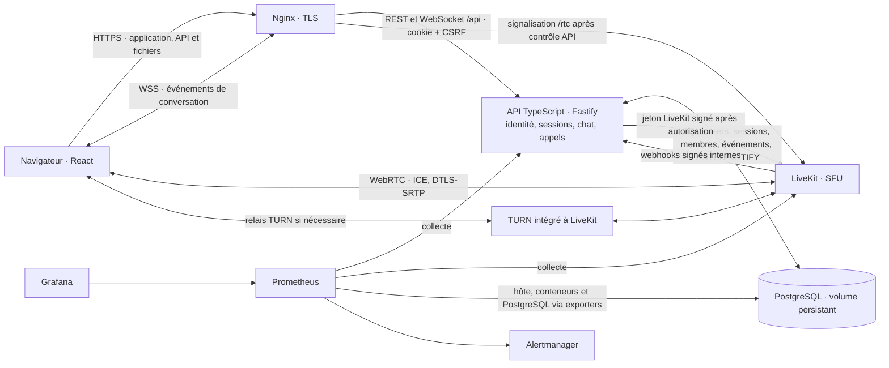

# ChatISEN — architecture et mandat de réalisation

**Pour l’équipe projet et pour le Codex qui pilotera les sous-agents GPT‑6.1 Terra.** Ce document spécifie le système à construire, les décisions de départ et la recette. Les chiffres de capacité, de latence et de reprise sont des objectifs de projet. Terra devra publier les valeurs effectivement mesurées avec leurs conditions de mesure.

## 1. Ce que l’on va construire

Alice ouvre ChatISEN dans son navigateur, crée son compte et retrouve Bob grâce à son identifiant public. Elle lui écrit. Bob voit le message sans recharger la page. Quand il revient le lendemain, il retrouve le même message dans l’historique. Alice peut aussi créer un groupe, lui donner un nom et gérer ses membres. Chacun voit qui a envoyé quoi et à quel moment.

Depuis la conversation, Alice lance un appel audio ou vidéo. Bob reçoit une invitation, peut accepter ou refuser, puis couper son micro ou sa caméra. Dans un groupe, d’autres membres peuvent rejoindre l’appel en cours. Le panneau de discussion reste accessible pour envoyer un fichier. Alice peut partager une fenêtre et arrêter le partage depuis le navigateur. Si le réseau se dégrade, l’interface l’indique. Si Bob perd brièvement sa connexion, il voit l’état de reconnexion puis retrouve les messages manqués.

Pour la soutenance, l’équipe fera tourner le service depuis un dépôt neuf. Elle montrera la conversation sur deux navigateurs, une conférence à trois, le refus d’accès à un tiers et la récupération après une coupure. Elle disposera d’un tableau de bord, d’une restauration testée, de résultats de charge et d’une petite étude sur la qualité des appels. ChatISEN est un projet académique indépendant de l’ISEN.

| Étape | Ce que l’équipe peut réellement montrer | Condition de passage |
|---|---|---|
| **J1 · Socle obligatoire** | Inscription, profil, session, messages privés et de groupe, temps réel, historique, appel audio puis vidéo à deux, déploiement et supervision de base | Une installation vierge passe la recette `core` avec deux sessions indépendantes et des pistes média reçues |
| **J2 · Cible complète de cette réalisation** | Conférence, partage de fichier et d’écran pendant l’appel, contrôles de groupe, qualité et reconnexion, gestion des pannes et montée en charge de l’API | Recette `full`, contrôles d’accès, reprise et démonstration sur des navigateurs distincts |
| **J3 · Évaluation et remise** | Déploiement reproductible, preuves de sécurité, sauvegarde restaurée, benchmarks, optimisation évaluée, analyse de données et PoC IA, rapport et démonstration | Chaque résultat renvoie à une exécution identifiable. Les limites et les écarts sont chiffrés ou expliqués |

**Lecture rapide.** L’[architecture](#architecture) explique comment les composants coopèrent. Les [contrats](#contrats) permettent aux agents de coder en parallèle. La [recette](#recette) définit les preuves attendues. Le [plan de délégation](#delegation) et le [prompt de lancement](#lancement) s’adressent au Codex pilote.

### Traduction du briefing en travail vérifiable

| Pages du PDF | Demande du sujet | Où la vérifier |
|---|---|---|
| 4–7, 12 | Produit, comptes, conversations, collaborations, six capacités du socle et extensions | J1/J2 et scénarios F01–F13 |
| 8–10, 12 | Performance, scalabilité, disponibilité, maintenabilité, exploitation, matières enseignées | Architecture, scénarios O01–O08 et P01–P04 |
| 11, 16 | Recherche, comparaison, choix d’architecture et de technologies justifiés | Tableau des décisions, ADR et livrable D01 |
| 13, 15 | Menaces, protections, validation, fiabilité et preuves de supervision | Scénarios S01–S05, O02–O07 et rapports d’exécution |
| 10, 14, 17 | Données d’usage et de qualité, IA avec résultats mesurés | Protocole de données, scénarios A01–A03 |
| 15–18 | Méthode d’évaluation, documentation, livrables et soutenance | D01–D03 et inventaire de remise |

La page 12 présente les extensions comme un choix de l’équipe. J2 retient celles qui rendent le parcours collaboratif complet. Pour la disponibilité, l’objectif est la reprise démontrée sur un hôte et la continuité du chat lors de la perte d’un processus API. La capacité à survivre à la perte d’une région demanderait un autre dimensionnement. [Briefing original](<ChatISEN - Project Briefing.pdf>)

<a id="architecture"></a>

## 2. Architecture retenue

**Pour reconstruire l’application de R01**, partir du lecteur de diagrammes au commit `bf1cd60`. Il associe les points d’entrée, les contrats HTTP et WebSocket, le schéma SQL, les écrans et les configurations à un test pour chaque vue. Le dessin ci-dessous présente la cible du mandat. [Ouvrir la visionneuse](docs/architecture/index.html#07-profils) · [Procédure de reconstruction](docs/architecture/README.md)

Un serveur Linux héberge l’application web, l’API, PostgreSQL et le serveur média LiveKit dans Docker Compose. L’API décide **qui a le droit** de lire une conversation ou de rejoindre une salle. PostgreSQL conserve **ce qui doit survivre** à un redémarrage. LiveKit transporte **ce qui doit arriver immédiatement** pendant un appel. Une panne du serveur média laisse donc la messagerie utilisable.



La flèche de collecte vers la base représente ses métriques via un exporter. Les paquets audio, vidéo et écran vont du navigateur à la SFU, directement ou par TURN. Ils ne traversent pas le processus Node. La SFU retransmet les pistes aux abonnés. PostgreSQL conserve les métadonnées d’appel, jamais les flux audio ou vidéo.

### Où l’authentification est gérée

L’authentification n’est pas un service séparé dans ChatISEN. Elle est gérée par le **module `identity` de l’API Fastify**, dans le même processus Node que les modules conversations et appels.

1. Le navigateur envoie l’inscription ou la connexion à l’API Fastify via Nginx en HTTPS.
2. Le module `identity` valide les champs avec TypeBox et vérifie le mot de passe avec `@node-rs/argon2` en Argon2id.
3. Après une connexion réussie, l’API crée une session aléatoire. Elle conserve uniquement le hash du jeton dans PostgreSQL, puis place le jeton opaque dans le cookie `__Host-chatisen` avec les attributs `Secure`, `HttpOnly`, `SameSite=Lax` et `Path=/`.
4. À chaque requête privée, l’API lit le cookie, compare son hash à la table `sessions`, vérifie l’expiration et charge l’utilisateur depuis `users`. Elle vérifie ensuite l’appartenance à la conversation avant de renvoyer une donnée.
5. Pour les modifications envoyées par le navigateur, le module vérifie en plus l’origine et le jeton CSRF HMAC produit avec `node:crypto`.
6. À l’ouverture ou à la reconnexion d’une WebSocket, le même module valide le cookie et l’appartenance avant de laisser le client s’abonner à une conversation. Une révocation ferme ou invalide la socket concernée.
7. Pour un appel, l’API ne transmet pas le mot de passe à LiveKit. Elle vérifie d’abord la session, le membre, l’appel et les droits dans PostgreSQL, puis utilise `livekit-server-sdk` pour signer un jeton LiveKit limité à cette salle et à cette durée.
8. LiveKit vérifie le jeton média signé et transporte les pistes. Il ne remplace pas le module d’authentification et ne décide pas seul des droits de conversation.

Nginx gère TLS et le routage. PostgreSQL conserve les comptes, les hash de mots de passe, les sessions et les appartenances. Fastify applique les règles. Argon2id protège les mots de passe. `node:crypto` produit les jetons et signatures. LiveKit reçoit uniquement un jeton média déjà autorisé. Le projet retient donc un **SSO local applicatif**, porté par le module `identity`, sans fournisseur externe ni serveur Keycloak séparé.

### Décisions à documenter et à éprouver

| Sujet | Choix de départ et raison | Alternative étudiée, coût et preuve à fournir |
|---|---|---|
| Client et API | React, Vite, TypeScript strict, API Fastify sur Node LTS, schémas TypeBox. Un client web couvre deux postes et partage les types du protocole | Comparer avec Next.js intégré. Ici, l’UI authentifiée tire peu de bénéfice du rendu serveur et l’API temps réel demande un cycle de vie propre. Vérifier le bundle, la compilation et F01–F05 |
| Découpage | Monolithe modulaire pour identité, conversations, événements et appels. Service média spécialisé, processus indépendants pour l’observation | Comparer avec des microservices métier. Compter les dépendances, expliquer les frontières, montrer qu’un arrêt média préserve le chat (O04) |
| Temps réel | Messages écrits en HTTPS, diffusion vers les clients en WebSocket natif. Journal ordonné dans PostgreSQL, réveil des réplicas par `LISTEN/NOTIFY` | Comparer avec Redis Pub/Sub + stockage SQL et avec le polling. Mesurer latence, requêtes et rattrapage (F04–F05, P01, P03). La base devient un point de contention mesurable |
| Appels | LiveKit auto-hébergé, SDK navigateur et serveur compatibles, SFU pour appels directs et groupes, TURN intégré | Comparer avec WebRTC pair à pair et maillage. La SFU consomme du débit serveur et simplifie les groupes, le NAT et l’observation. Mesurer le débit client/serveur à deux et à quatre (F06–F08, P02) |
| Pièces jointes | Fichier limité à 5 Mio, métadonnées et contenu binaire dans PostgreSQL. Message et fichier validés dans la même transaction | Comparer avec un stockage objet privé. Quantifier l’impact sur taille de base, téléchargement et restauration (F09, O06, P04). Un stockage objet devient pertinent si ces coûts dépassent les cibles |
| Livraison | Monodépôt pnpm, images OCI figées, Docker Compose sur Linux, Nginx pour TLS, OpenTofu et Ansible pour le déploiement | Comparer avec Kubernetes managé. Évaluer le temps d’installation, la capacité d’une VM et l’effet d’une panne d’hôte (O01, O05–O08) |
| Observabilité et étude | Prometheus, Grafana, Alertmanager, logs JSON, Python/pandas/scikit-learn pour l’analyse hors ligne | Comparer coût d’une pile de logs centralisée et lecture ciblée par service. Évaluer couverture, coût de collecte et résultat du modèle (O02–O03, A01–A03) |

#### Comparaison détaillée avant choix final

Le tableau précédent donne la synthèse. Cette seconde matrice conserve le raisonnement nécessaire pour le rapport et pour les ADR. Le nom en gras est le choix à construire. La colonne « écarté » explique pourquoi les autres options ne sont pas retenues dans notre contexte.

| Décision | Options examinées | Pourquoi les autres options sont écartées | Choix final conservé | Test qui valide le raisonnement |
|---|---|---|---|---|
| Authentification et SSO | Keycloak, Authentik, OAuth externe, authentification par module séparé, SSO local applicatif | Keycloak et Authentik sont solides, mais ils ajoutent plusieurs conteneurs, une base, une configuration d’Identity Provider, un onboarding des utilisateurs et une charge d’administration trop importante pour ce projet académique. OAuth dépend d’un fournisseur et d’un réseau externes. Un module différent par fonctionnalité créerait plusieurs sources de vérité. | **SSO local applicatif dans le module identity de Fastify** avec PostgreSQL, cookie de session unique, Argon2id, CSRF et jetons LiveKit signés. | F01, S01, S02 et S03. Vérifier qu’une session sert le frontend, l’API, la WebSocket et l’admission média, puis qu’une révocation les invalide toutes |
| Base de données | PostgreSQL, MySQL, MongoDB, SQLite, Redis | SQLite ne convient pas aux deux API ni aux connexions persistantes de la démo. MongoDB rend les documents simples, mais les contraintes d’appartenance, l’ordre séquentiel et les transactions sont centraux. Redis ne conserve pas seul l’historique métier. MySQL est possible, mais PostgreSQL couvre directement notifications, verrous, données binaires et restauration. | **PostgreSQL 17** | Migrations sur base vide, écritures concurrentes F02–F05, notification LISTEN/NOTIFY, arrêt/redémarrage et restauration O06 |
| API backend | Express, NestJS, Fastify | Express laisse plus de plomberie pour schémas, hooks et erreurs. NestJS apporte une structure importante et des décorateurs dont le coût dépasse le besoin du monolithe. | **Fastify 5 sur Node 24 LTS** | Contrats OpenAPI, erreurs communes, p95 des routes et comportement O04 quand PostgreSQL ou LiveKit est indisponible |
| Contrats JSON | Validation manuelle, Zod, JSON Schema seul, TypeBox | La validation manuelle se répète. Zod demande une conversion supplémentaire pour le contrat OpenAPI et le provider Fastify. JSON Schema seul ne donne pas l’inférence TypeScript attendue. | **TypeBox avec type-provider Fastify** | Un schéma produit validation runtime, types TypeScript et OpenAPI. Les exemples valides et invalides passent les tests de contrat |
| Frontend | React/Vite, Next.js, Vue/Nuxt | Next.js apporte du rendu serveur peu utile pour l’interface authentifiée et ajoute des conventions full-stack. Vue/Nuxt changerait le langage et l’écosystème sans avantage pour WebRTC. | **React 19, Vite 7 et TypeScript strict** | Build statique derrière Nginx, typecheck, bundle mesuré et F01–F13 sur deux tailles d’écran |
| Architecture backend | Microservices, monolithe sans modules, monolithe modulaire | Les microservices multiplient les déploiements, contrats réseau et pannes distribuées avant d’apporter un gain mesuré. Un monolithe sans modules mélange les responsabilités et les droits. | **Monolithe modulaire Fastify** avec identity, chat, calls, files et telemetry, LiveKit restant un service spécialisé | Arrêt de LiveKit avec chat utilisable, tests d’imports entre modules et scénario O04 |
| Accès PostgreSQL | Prisma, Drizzle, TypeORM, Kysely, driver direct | Les ORM masquent une partie des verrous, séquences et transactions nécessaires. Prisma ajouterait son moteur. Drizzle et Kysely sont possibles, mais la cible a besoin de SQL explicite et d’une connexion LISTEN dédiée. | **Driver pg et repositories SQL paramétrés** | Plans EXPLAIN, verrous FOR UPDATE, concurrence, injection SQL et listener séparé dans F05 |
| Migrations | Prisma Migrate, Drizzle Kit, Knex, TypeORM, SQL manuel, node-pg-migrate | Prisma et Drizzle lient les migrations à un ORM non retenu. SQL manuel ne prouve pas l’ordre ni la version. Knex ajoute une abstraction de requêtes qui n’est pas nécessaire. | **Bibliothèque node-pg-migrate**. Elle applique les fichiers SQL ou JavaScript numérotés et enregistre la version de schéma | Base vide, seconde exécution sans doublon, compatibilité avec l’ancienne API, O01 et O07 |
| Temps réel | Polling, SSE, Redis Pub/Sub, NATS, WebSocket | Le polling ajoute latence et requêtes inutiles. SSE couvre moins bien les échanges bidirectionnels. Redis ou NATS ajouteraient un service critique et ne seraient pas le journal durable des messages. | **WebSocket natif, journal PostgreSQL et LISTEN/NOTIFY** | F04–F05, reconnexion, déduplication, saut de séquence, rattrapage et P01 |
| Audio et vidéo | WebRTC pair à pair, maillage navigateur, Jitsi, Janus, LiveKit | Le pair à pair et le maillage deviennent coûteux avec quatre participants. Jitsi apporte une plateforme complète plus large que le besoin. Janus demande davantage d’intégration WebRTC maison. | **LiveKit Server auto-hébergé avec SDK client et serveur, SFU et TURN intégré** | F06–F08, média reçu, conférence à quatre, ICE direct, ICE relay, qualité F11 et panne O04 |
| Stockage des fichiers | Binaire dans PostgreSQL, MinIO, S3 public, S3 privé | Un stockage objet serait adapté à de gros volumes, mais ajoute bucket, credentials, politiques réseau et une seconde cohérence à démontrer. La limite de 5 Mio rend le stockage transactionnel acceptable pour la démo. | **Binaire dans PostgreSQL avec bytea**, empreinte SHA-256 et transaction avec le message | F09, téléchargement autorisé, abandon multipart, fichier de 5 Mio, aucun orphelin et impact O06/P04 |
| Design frontend | CSS natif, CSS Modules, Tailwind CSS, Material UI | Tailwind et Material UI apportent des conventions et des composants visuels qui masqueraient une partie du travail d’interface et ajoutent une dépendance de design. Une feuille CSS globale seule crée des collisions de classes. | **CSS natif organisé par CSS Modules**, variables CSS de tokens et composants React écrits dans le projet | Navigation clavier, axe-core, focus, contraste, responsive 390/1280 px et F13 |
| Proxy et TLS | Nginx, Traefik, Caddy, Node exposé directement | Exposer Node directement augmente la responsabilité applicative pour TLS, headers et fichiers statiques. Traefik et Caddy restent possibles, mais Nginx fournit ici un routage explicite et documenté pour API, WebSocket, SPA et LiveKit. | **Nginx, Certbot en public, mkcert ou CA locale en développement** | HTTPS, WSS, renouvellement ACME, headers, upload et contrôle d’admission |
| Déploiement | Kubernetes, Swarm, services managés, Docker Compose | Kubernetes est adapté à plusieurs nœuds, mais impose ingress, secrets, opérateurs et observabilité plus lourde. Les services managés ajoutent coût et dépendance cloud. | **Docker Compose v2** sur VM Linux, images OCI figées, OpenTofu et Ansible | Installation vierge O01, second déploiement identique, volumes persistants et O07–O08 |
| Observabilité | Logs Docker seuls, ELK/OpenSearch, Datadog, Prometheus/Grafana | Les logs seuls ne donnent ni percentiles ni alertes. ELK/OpenSearch consomme trop de ressources sur la VM de référence. Datadog ajoute compte, coût et dépendance externe. | **Pino JSON, prom-client, Prometheus, Grafana et Alertmanager** | O02–O03, labels bornés, corrélation requestId, alerte active et retour à la normale |
| Tests navigateur | Selenium, Cypress, Playwright | Selenium demande plus de plomberie. Cypress convient à l’UI, mais les contextes multiples, WebSocket et scénarios WebRTC sont mieux contrôlés par Playwright. | **Playwright Chromium et Firefox**, médias synthétiques en CI et tests guidés pour permissions natives | F01–F07, F09, F11, F13 en CI, puis F08/F10/F12 sur postes et réseaux distincts |
| Charge | JMeter, Artillery, k6, scripts maison | JMeter est lourd pour une API TypeScript. Artillery couvre HTTP/WS, mais k6 fournit un scénario lisible et des métriques standard. Les scripts maison rendent les comparaisons moins reproductibles. | **k6 pour HTTP et WebSocket**, navigateurs réels pour WebRTC, tc/netem pour les dégradations | P01–P03, trois répétitions, p50/p95/p99, CPU/RAM/DB et artefacts bruts |
| Analyse et IA | Python, Node.js, notebook non verrouillé | Node réutiliserait le runtime applicatif, mais Python possède l’écosystème le plus direct pour nettoyage, statistiques et évaluation. Un notebook seul se reproduit mal. | **Python 3.12, uv, pandas, scikit-learn et matplotlib**, avec scripts versionnés et seed | A01–A03, export gelé, séparation par appel, baseline comparée et purge |

Terra consignera les versions exactes compatibles, les liens vers la documentation des versions choisies, une alternative crédible, le motif et le test dans des ADR courts. Base de départ cohérente à valider au bootstrap : Node 24 LTS, pnpm 10, Fastify 5, PostgreSQL 17. Épingler le gestionnaire, les SDK LiveKit, les dépendances, les images et les providers IaC dans leurs mécanismes de verrouillage. Tester le couple SDK/serveur par un appel réel avant de figer l’ADR média.

### Technologies retenues, composant par composant

Cette matrice est la référence de départ pour les agents. Une version ultérieure peut être retenue seulement si le test de compatibilité associé passe et si un ADR explique la différence. Les versions majeures sont des repères de bootstrap. Le lockfile et les digests d’images deviennent la version effectivement livrée.

### Lecture humaine des choix

**La base de données retenue est PostgreSQL 17.** PostgreSQL est le serveur de base de données qui stocke les comptes, conversations, messages, appels, fichiers et mesures. En local, il tourne dans un conteneur Docker avec un volume persistant. En démo, il tourne sur la VM. Le code de ChatISEN ne remplace pas PostgreSQL par une autre base.

**`node-pg-migrate` est la bibliothèque de migrations retenue.** Ce n’est pas une base de données. C’est un paquet npm exécuté pendant le développement et le déploiement pour appliquer dans l’ordre des fichiers de migration versionnés, par exemple `001-create-users.sql`, puis `002-create-conversations.sql`. Il crée ou modifie les tables. L’application en fonctionnement utilise ensuite le driver **`pg`** pour lire et écrire dans PostgreSQL. Terra devra faire passer les migrations sur une base vide, puis vérifier qu’une seconde exécution ne recrée rien.

**Fastify est le framework HTTP de l’API Node.js.** Il joue un rôle comparable à Express. Il reçoit les requêtes REST, vérifie les entrées, appelle les modules métier et renvoie les réponses JSON. Le plugin `@fastify/websocket` ajoute la connexion temps réel. Fastify n’est ni la base de données ni le serveur média.

**TypeBox décrit les formats JSON de l’application.** Terra écrit par exemple un schéma `CreateMessage` avec `conversationId`, `clientId` et `text`. TypeBox sert à la fois à valider les données reçues au runtime, à produire les types TypeScript pendant la compilation et à alimenter OpenAPI. Les schémas TypeBox sont donc le contrat partagé entre le frontend, l’API et les tests.

**Le design utilise du CSS natif organisé avec CSS Modules.** Chaque écran possède des fichiers `.module.css` dont les classes sont isolées. Les couleurs, espacements, rayons et tailles communes sont des variables CSS dans un fichier de tokens. Le projet ne retient ni Tailwind CSS ni Material UI. `eslint-plugin-jsx-a11y` et `axe-core` servent aux contrôles d’accessibilité, ils ne sont pas une bibliothèque de design.

**LiveKit est le serveur média retenu.** `livekit-client` est le SDK installé dans le navigateur et `livekit-server-sdk` est le SDK utilisé par l’API pour créer des jetons d’accès. LiveKit transporte les pistes audio, vidéo et partage d’écran via WebRTC et joue le rôle de SFU pour les groupes. L’application conserve les droits, les membres et l’état métier dans PostgreSQL. Elle ne fabrique pas elle-même une signalisation WebRTC complète.

**Les outils qui entourent l’application ont des rôles distincts.** Nginx est le reverse proxy et termine TLS. Docker Compose lance les services. OpenTofu décrit l’infrastructure. Ansible configure la VM. Prometheus collecte les métriques. Grafana les affiche. Playwright teste le navigateur. k6 mesure l’API et les WebSockets. Python sert uniquement à l’analyse de données et au PoC IA.

**Les mots “retenue” et “alternative” sont séparés.** Le nom en gras dans la deuxième colonne est le choix de construction demandé à Terra. Le texte d’explication peut citer une alternative pour justifier le choix. Une alternative ne doit pas être implémentée en parallèle, sauf si un test comparatif la demande explicitement.

### Petit glossaire pour suivre le tableau

| Terme | Signification dans ChatISEN |
|---|---|
| API | Programme auquel le navigateur envoie des requêtes. Ici, l’API Fastify vérifie l’identité, applique les règles métier et parle à PostgreSQL et LiveKit |
| REST | Forme d’API HTTP organisée autour de routes comme `POST /messages` ou `GET /conversations`. Les messages eux-mêmes sont envoyés en HTTP puis distribués en WebSocket |
| SDK | Bibliothèque fournie par un outil pour l’utiliser depuis notre code. `livekit-client` est le SDK navigateur. `livekit-server-sdk` est le SDK serveur |
| Runtime | Moment où le programme tourne réellement. Une validation TypeBox au runtime vérifie le JSON reçu par l’API. La vérification TypeScript intervient avant le lancement, pendant la compilation |
| OpenAPI | Document machine-readable qui décrit les routes HTTP, leurs entrées et leurs réponses. Il sert à générer une documentation et à tester le contrat |
| WebSocket | Connexion persistante entre navigateur et API. Elle permet au serveur d’envoyer immédiatement un nouveau message ou une invitation d’appel |
| WebRTC | Technologie du navigateur utilisée pour transporter audio, vidéo et partage d’écran. LiveKit fournit les composants serveur nécessaires pour les appels de groupe |
| SFU | Serveur qui reçoit une piste média et la redistribue aux participants. LiveKit joue ce rôle. Les navigateurs n’ont donc pas à envoyer une copie séparée à chaque participant |
| TURN | Relais réseau utilisé quand deux appareils ne peuvent pas établir un chemin direct. Il transporte alors le média via le serveur LiveKit |
| TLS | Chiffrement de la connexion HTTPS, WebSocket sécurisé et TURN sécurisé. Le certificat prouve au navigateur l’identité du domaine |
| HMAC | Signature calculée avec un secret partagé. Elle sert ici à vérifier qu’un jeton CSRF ou un webhook provient bien du service attendu |
| CSRF | Protection contre une page externe qui tenterait de faire effectuer une mutation au navigateur d’un utilisateur déjà connecté |
| Migration | Fichier versionné qui fait évoluer la structure PostgreSQL. Une migration crée une table, ajoute un index ou modifie une colonne. `node-pg-migrate` les applique dans l’ordre |
| Driver SQL | Bibliothèque qui ouvre une connexion à PostgreSQL et exécute des requêtes. Ici, `pg` est le driver. Il ne remplace pas PostgreSQL |
| Reverse proxy | Serveur placé devant l’API. Nginx reçoit la connexion publique, gère TLS et transmet la requête au bon conteneur |
| Image OCI | Paquet immuable contenant une application et son environnement. Docker lance cette image sous forme de conteneur |
| Exporter | Petit service qui transforme les métriques d’un composant en format lisible par Prometheus. `postgres_exporter` fait cela pour PostgreSQL |
| SBOM | Inventaire des bibliothèques et paquets présents dans une image. Syft le génère pour que la composition de la livraison soit connue |
| p95 et p99 | Valeurs sous lesquelles se trouvent respectivement 95 % et 99 % des mesures. Elles montrent les cas lents que la moyenne masque |

| Composant | Technologie retenue | Responsabilité dans ChatISEN | Justification pour ce projet | Test de choix et de fonctionnement |
|---|---|---|---|---|
| Client web | **React 19**, **Vite 7**, **TypeScript strict** | Rendre les écrans authentifiés, les fils, la grille d’appel et les états de reconnexion | React fournit une composition claire pour plusieurs états simultanés. Vite donne un démarrage rapide et un build statique adapté à Nginx. TypeScript partage les contrats avec l’API et réduit les erreurs sur les événements temps réel | `pnpm typecheck`, build de production servi par Nginx, parcours Playwright F01–F13 et contrôle de taille du bundle |
| Routage et état UI | **React Router 7**, **Zustand 5** pour l’état de session/appel, **TanStack Query 5** pour les lectures et mutations HTTP | Distinguer navigation, état éphémère de l’appel et données serveur paginées | Ces rôles séparés évitent de mettre les messages ou les pistes média dans un store global unique. TanStack Query gère cache, invalidation et retry. Zustand reste petit pour l’état local qui doit survivre aux changements d’écran | Recharger pendant un envoi, naviguer entre deux conversations et reconnecter une socket. L’état attendu est conservé sans duplication F04, F05 et F13 |
| Design et accessibilité | **CSS Modules**, **CSS natif avec tokens**, `eslint-plugin-jsx-a11y`, **axe-core** dans Playwright | Style responsive, focus, contrastes, états d’erreur et commandes clavier | CSS natif et modules évitent une couche de composants visuels qui masquerait le comportement. Les tokens stabilisent la démonstration à 390 et 1280 px. axe détecte les régressions courantes | Tests axe sans violation critique, navigation clavier F13 et captures de référence à chaque taille |
| WebSocket navigateur | **API WebSocket native** côté navigateur et **`@fastify/websocket` avec `ws`** côté Node | Transport des événements de conversation et des notifications personnelles | Le protocole est petit, inspectable et compatible avec plusieurs réplicas. WebSocket évite le coût du polling et ne mélange pas le transport de messages avec la signalisation WebRTC | Test de reconnexion, duplication, saut de séquence, backpressure et rattrapage F04–F05. Vérifier que deux sockets ne reçoivent que les conversations autorisées |
| API HTTP | **Fastify 5** sur **Node 24 LTS**, **TypeScript**, `@fastify/cookie`, `@fastify/multipart` | Authentification, conversation, fichiers, appels, qualité, santé et métriques | Fastify offre des hooks, des schémas et une faible surcharge sur une API qui doit aussi servir les sockets. Node permet de partager les types et les primitives cryptographiques avec le client de protocole | Tests de contrat OpenAPI, p95 de route P01, multipart F09 et comportement O04 quand PostgreSQL ou LiveKit est arrêté |
| Validation des entrées | **TypeBox** et **`@fastify/type-provider-typebox`** | Définir les schémas JSON, les DTO et les erreurs communes | Un seul schéma produit validation runtime, types TypeScript et documentation OpenAPI. Cela réduit le risque de divergence entre Terra backend et Terra frontend | Générer OpenAPI depuis les routes, tester les exemples valides/invalides et exécuter un test de compatibilité sur chaque changement de schéma |
| Base de données | **PostgreSQL 17** | Source durable pour comptes, membres, journal ordonné, appels, fichiers, jobs et mesures | Les transactions, contraintes uniques, verrous de ligne, `LISTEN/NOTIFY` et `bytea` couvrent les besoins sans ajouter un broker obligatoire. Les données restent faciles à sauvegarder et à inspecter au jury | Migrations sur volume vide, transactions concurrentes F02–F05, arrêt/redémarrage O04 et restauration O06 |
| Accès SQL | **`pg` 8** avec requêtes SQL paramétrées et une couche de repositories explicite | Pool métier, connexion dédiée au listener, transactions et curseurs | Le projet dépend de comportements SQL précis (`FOR UPDATE`, séquences, idempotence et notifications). Le driver direct rend les plans et verrous visibles. Une couche de repositories garde les modules testables sans cacher les transactions | Tests d’intégration sur PostgreSQL réel, `EXPLAIN` des lectures paginées P04 et test du listener séparé lors de F05 |
| Migrations | **`node-pg-migrate`** | Migrations numérotées et irréversibles ou réversibles selon le risque | Les migrations vivent dans le dépôt, s’exécutent avant l’API et se testent sur une base jetable. Le format SQL reste lisible pour le rapport | Appliquer deux fois, démarrer une version précédente contre une migration compatible, puis exécuter O01 et O07 |
| Hash et secrets applicatifs | **`@node-rs/argon2`** pour Argon2id, **`node:crypto`** pour aléa, SHA-256 et HMAC | Hash des mots de passe, jetons de session et signatures internes | Argon2id résiste au bruteforce et fournit des binaires adaptés au poste macOS arm64 et à Linux. Les primitives natives évitent d’introduire une bibliothèque cryptographique généraliste supplémentaire | Vérifier le hash non réversible, mesurer le coût Argon2id sur la VM, tester la rotation/révocation et vérifier l’absence de secrets dans les logs S01/S04 |
| Session et CSRF | Cookie `__Host-chatisen` via **`@fastify/cookie`**, jeton CSRF HMAC lié à la session via **`node:crypto`** | Session opaque, expiration, logout, protection des mutations navigateur | Un cookie HttpOnly réduit l’exposition du jeton. Le jeton CSRF lié à la session convient à une application même origine et reste vérifiable sur chaque réplica sans secret par utilisateur | F01 et S01 sur attributs cookie, origine étrangère, token absent, rotation, expiration, logout et socket ouverte |
| Limitation d’abus | **`@fastify/rate-limit`** pour la protection locale, compteurs SQL bornés pour login et écritures partagés entre réplicas | Réduire bruteforce, spam de messages, multipart et qualité | Le plugin couvre le coût immédiat par processus. Les compteurs SQL répondent au besoin de cohérence de la cible à deux API sans imposer Redis avant d’avoir mesuré la charge | Atteindre chaque limite, obtenir `429` et `Retry-After`, puis répéter avec deux API O05 et S01 |
| Média temps réel | **LiveKit Server** auto-hébergé, **`livekit-client`** côté navigateur, **`livekit-server-sdk`** côté API | SFU, salles, pistes audio/vidéo/écran, statistiques et jetons d’accès | LiveKit fournit la signalisation, la SFU, les participants et les statistiques dont une implémentation WebRTC maison aurait la charge. La SFU garde le groupe viable quand le nombre de participants augmente | Appel audio/vidéo réel F06–F08, conférence à quatre, média reçu et stats `getStats` cohérentes. Tester le couple de versions avant de figer l’ADR |
| Relais média | **TURN intégré de LiveKit**, UDP multiplexé et TURN/TLS selon le profil réseau | Traverser NAT et réseaux qui ne peuvent pas établir un chemin direct | Garder le relais dans la même distribution évite de synchroniser un serveur coturn séparé pour cette cible. Le profil public expose uniquement les ports nécessaires et mesure le coût du relais | ICE forcé en `relay`, essai UDP indisponible, essai TURN/TLS et preuve de la candidate pair F08/S03 |
| Admission média | Module appels **Fastify** avec **`livekit-server-sdk`**, sous-requête **Nginx** interne et webhook LiveKit signé | Vérifier session, appartenance, état d’appel, salle et révocation avant signalisation | Le jeton LiveKit seul ne connaît pas les règles de conversation. Le contrôle près de Nginx et le webhook relient l’identité applicative à l’état réel de la SFU | Réutilisation d’un ancien jeton, retrait pendant appel, webhook invalide, doublon et retour de la SFU S03/O04 |
| Reverse proxy et TLS | **Nginx** stable, certificats ACME via **Certbot** en démo publique, CA **mkcert** ou CA OpenSSL en local | Servir le build, terminer TLS, router API/WS/LiveKit et masquer les routes privées | Nginx est léger, documenté et adapté à un serveur unique. Le domaine unique simplifie les cookies, l’origine et la démonstration. Certbot automatise le renouvellement sans service cloud supplémentaire | Vérifier HTTP→HTTPS, WSS, taille multipart, headers CSP/nosniff, renouvellement en environnement de test et routage O07/S04 |
| Conteneurs locaux et démo | **Docker Engine** et **Docker Compose v2** avec images OCI multi-architecture | Lancer API, web, DB, LiveKit, Nginx, Prometheus et Grafana avec réseaux/volumes explicites | Compose permet au jury de reproduire l’ensemble sur un seul poste, y compris macOS arm64. Les images rendent les versions et les limites de ressources observables | `make doctor`, `make bootstrap`, deux `make up`, volumes persistants, profil `demo` et smoke test O01 |
| Infrastructure | **OpenTofu 1.x** avec provider **Hetzner Cloud** pour la référence, **Ansible 2.17** pour la configuration | Décrire VM, pare-feu, réseau, disque, installation et livraison | OpenTofu est une interface IaC ouverte. Hetzner donne une VM européenne peu coûteuse pour la démo. Ansible garde les étapes de système lisibles et idempotentes pour une VM existante ou provisionnée | `tofu fmt/validate/plan`, état sans secret, deux passages Ansible, ports conformes et O07–O08 |
| CI et publication | **GitHub Actions**, **pnpm** avec lockfile, **BuildKit**, `docker/build-push-action`, **Syft** pour SBOM et **Trivy** pour le scan | Vérifier chaque changement, construire les images et publier un manifeste versionné | Le pipeline est largement disponible sur les hébergeurs Git courants et fournit des runners Linux pour les tests reproductibles. BuildKit produit les mêmes images que Compose. SBOM et Trivy alimentent la remise sécurité | Pipeline sur clone neuf, cache désactivé une fois, digests identiques entre build et déploiement, scan daté S05/O01 |
| Tests unitaires et intégration | **Vitest**, `@fastify/inject`, **Testcontainers Node** pour PostgreSQL et LiveKit | Vérifier fonctions, routes et assemblage contrôlé sans dépendre d’une VM publique | Vitest partage TypeScript et exécution rapide. `@fastify/inject` teste les routes sans socket réseau. Testcontainers fait passer les tests transactionnels sur les vrais services | `make test-unit`, `make test-integration`, migrations réelles et tests de panne O04 |
| Parcours navigateur | **Playwright Chromium et Firefox**, WebRTC avec sources média synthétiques Chromium, parcours manuels pour permissions natives | Exécuter la recette UI, deux contextes isolés, messages, appels et erreurs | Playwright synchronise les deux navigateurs et capture traces, vidéos et réseau. Les sources synthétiques rendent l’audio/vidéo vérifiable en CI. Le sélecteur d’écran reste un test guidé car le navigateur le contrôle nativement | F01–F07, F09, F11, F13 en CI, puis F08/F10/F12 guidés sur deux réseaux ou deux postes |
| Charge | **k6** pour HTTP/WS, clients navigateur contrôlés pour le média, **`tc/netem`** ou un banc réseau équivalent | Paliers P01–P03, latence, pertes, reconnexions et saturation | k6 mesure beaucoup de clients avec une définition de scénario lisible. WebRTC doit être mesuré avec des clients réels. `netem` rend la dégradation répétable sur Linux | Trois répétitions par palier, p50/p95/p99, CPU/RAM/DB, chemin ICE et artefacts bruts P01–P03 |
| Observabilité applicative | **Pino JSON**, **`prom-client`**, **Prometheus 3.x**, **Grafana 12.x**, **Alertmanager 0.x** | Logs corrélés, compteurs/histogrammes, tableaux et alertes | Pino limite le coût du logging. Prometheus/Grafana sont composables, locaux et faciles à montrer. Alertmanager permet un récepteur de démonstration sans intégrer un fournisseur de notification | O02–O03, recherche par `requestId`, métriques à labels bornés et alertes active/résolue |
| Métriques infrastructure | **`node_exporter`**, **cAdvisor**, **`postgres_exporter`**, endpoint métriques LiveKit | CPU, mémoire, disque, conteneurs, PostgreSQL et SFU | Ces exporters couvrent les points de saturation attendus sans agent propriétaire. Ils donnent une base comparable entre portable et VM | Arrêter un conteneur, remplir un volume jetable et produire O02/O03 avec unités et fenêtre UTC |
| Sauvegarde | **`pg_dump`** custom chiffré par **age**, stockage séparé local ou objet compatible S3, tâche systemd/cron supervisée | Sauvegarde quotidienne, rétention, âge et restauration | Le format custom permet restauration sélective et vérification. `age` sépare la clé du fichier. Une cible S3-compatible permet de tester un stockage séparé sans enfermer l’application dans un fournisseur | Vérifier SHA-256, restaurer un stack vierge, mesurer RPO/RTO et tester que le backup est inutilisable sans la clé O06 |
| Analyse de données | **Python 3.12**, **`uv`**, **pandas**, **scikit-learn**, **matplotlib** | Nettoyer les stats WebRTC, comparer baseline et modèle et produire les figures | Python dispose des outils scientifiques demandés par le sujet. `uv` rend l’environnement d’étude verrouillable et indépendant du runtime Node | `make study` depuis un export gelé, seed fixé, séparation par appel, métriques A01–A03 et purge à 7 jours |
| Documentation et diagrammes | **Markdown**, **Mermaid**, **OpenAPI**, ADR dans `docs/` | Expliquer architecture, choix, exploitation, protocole et preuves | Ces formats sont versionnables et lisibles par le jury sans outil propriétaire. Mermaid garde les schémas près du code | Vérifier les liens, générer OpenAPI, rendre les diagrammes, suivre la matrice PDF → exigence → test → preuve D01 |

### Arborescence cible et interfaces de travail

```text
apps/web/                  client React, parcours et états d’erreur
apps/api/                  bootstrap, modules identity, chat, calls, telemetry
packages/contracts/        schémas HTTP, enveloppes WS, erreurs, exemples versionnés
db/migrations/             migrations SQL numérotées, ordre unique
infra/compose/             services, profils local, démo et mesure
infra/edge/                Nginx, TLS, routes privées/publiques
infra/media/               configuration LiveKit, profils ICE/TURN
infra/tofu/                VM, réseau, pare-feu et sorties sans secret
infra/ansible/             configuration hôte, livraison et retour de version
ops/                       métriques, dashboards, alertes, sauvegarde, runbooks
tests/{contract,e2e,load,reliability,security}/
analysis/                  dictionnaire, collecte, préparation, modèle, évaluation
docs/                      spécification, ADR, exploitation, rapports et soutenance
artifacts/                 résultats par exécution, manifeste et index de preuves
Makefile                   commandes stables pour développeur, CI et jury
```

## 3. Persistance et règles métier

Utiliser des UUID pour les identifiants publics, des instants UTC fournis par le serveur et des clés étrangères explicites. Les séquences de conversation sont des entiers 64 bits en base et des chaînes décimales en JSON. L’ordre d’affichage repose sur la séquence. Le nom d’affichage peut changer. Le `handle` public unique est normalisé en minuscules et reste stable.

| Table ou ensemble | Champs et contraintes indispensables |
|---|---|
| `users`, `sessions` | Utilisateur, handle unique, nom affiché, hash Argon2id, date de création. Session : identifiant public interne, utilisateur, hash d’un jeton aléatoire de 256 bits, création, dernière activité, expiration absolue et révocation. Index sur hash et expiration |
| `conversations`, `conversation_members` | Type `direct/group`, titre pour groupe, paire canonique triée unique pour un direct, compteur `last_seq`. Appartenance unique par conversation/utilisateur, rôle `owner/member`, dates d’entrée/sortie. Index des appartenances actives. Un seul propriétaire actif pour un groupe |
| `conversation_events` | PK `(conversation_id, seq)`, type, version, référence métier, date. Journal durable des messages, changements de groupe et d’état d’appel. Contenu d’événement borné. Chaque écriture visible et son événement sont atomiques |
| `messages`, `attachments` | Message lié à la conversation, à son auteur et à sa séquence unique. Texte ou pièce jointe. Clé client et empreinte de la commande pour les retries. Fichier avec nom d’affichage, type vérifié, taille, empreinte SHA‑256 et `bytea`. Un fichier appartient à un seul message |
| `calls`, `call_participants` | Appel lié à la conversation et à son initiateur, mode audio/vidéo, dates et état. Index partiel : au plus un appel non terminé par conversation. Salle nommée avec l’UUID d’appel. Participation et admission média liées à appel, utilisateur et session, état, identité LiveKit opaque unique, dates. Journaliser les motifs de fin |
| `media_jobs`, `webhook_receipts` | Tâches durables et idempotentes de retrait de participant ou fermeture de salle, avec compteur d’essais et échéance. Événements fournisseur dédupliqués par identifiant. Purge planifiée après la fenêtre de diagnostic |
| `quality_samples` | Session d’étude pseudonymisée, fenêtre, version du schéma, mesures numériques, scénario expérimental si applicable. Index sur temps. Séparer données de mesure et secrets d’identité |

**Règles que deux implémentations doivent interpréter de la même façon**

1. L’inscription requiert un handle de 3 à 32 caractères `[a-z0-9_]`, un nom de 1 à 80 caractères et un mot de passe de 12 à 128 caractères. La recherche de contact authentifiée utilise le handle exact. Les mots de passe restent sous forme de hash salé. En local et en démo, les comptes sont autonomes, sans dépendance à un annuaire ISEN.
2. Ouvrir deux fois un direct Alice–Bob, même simultanément dans les deux sens, retourne la même conversation. Le créateur d’un groupe en devient propriétaire. Il peut renommer, ajouter et retirer des membres. Un membre peut quitter un groupe. Le propriétaire transfère son rôle à un membre actif avant de partir ou clôt le groupe s’il en est le dernier membre. Un direct garde ses deux membres. Règle d’historique choisie : un membre actif accède à tout l’historique, y compris les messages antérieurs à son entrée. Après sa sortie, les prochaines lectures, écritures et admissions lui sont refusées.
3. Les actions qui changent une conversation prennent le verrou de sa ligne dans un ordre commun, vérifient l’accès dans la transaction, attribuent la séquence suivante, insèrent données et événement puis appellent `pg_notify` dans cette transaction. Le payload contient uniquement conversation et séquence. Une transaction annulée ne produit ni message visible ni trou. L’unicité en base arbitre les créations concurrentes. Les commandes réessayables portent un UUID client. Même clé, même auteur, même conversation et même contenu : renvoyer le résultat initial. Même clé et contenu différent : `409`. Tester le cas où l’écriture a réussi et la réponse HTTP s’est perdue.
4. Le client possède un état `envoi / envoyé / à réessayer`. Il conserve la même clé pour un retry et fusionne le résultat HTTP avec l’événement WS. L’API ouvre une connexion PostgreSQL dédiée à `LISTEN`, distincte du pool métier. Chaque réplica dessert ses propres sockets, relit le journal dans l’ordre et revalide session et appartenance avant livraison. Une reconnexion au listener et une vérification périodique des curseurs (10 s) rattrapent les notifications perdues. Heartbeat WS, file d’envoi bornée et resynchronisation d’un client lent empêchent une socket de bloquer les autres.
5. Chaque opération sur un fichier vérifie l’appartenance au moment de la requête. Le binaire reste hors du journal et des événements WS. Recevoir le multipart avec limite de taille et de concurrence avant de charger le binaire en mémoire. Autoriser PNG, JPEG, PDF et texte brut UTF‑8, vérifier signature ou encodage et générer l’identifiant côté serveur. Servir en téléchargement avec nom encodé, type sûr, `nosniff` et cache privé désactivé. Un échec laisse zéro message ou fichier orphelin.
6. L’appel commence à `ringing`. Le créateur peut se connecter. L’événement de sonnerie atteint les membres connectés. Un second participant réellement connecté fait passer l’appel à `active`. En direct, refus du destinataire ou départ explicite de l’un termine l’appel. En groupe, un refus reste individuel, un départ laisse les autres discuter. Sonnerie sans réponse : fin après 45 s. Groupe actif vide : fermeture après 30 s de grâce. Déconnexion média involontaire : grâce de 30 s avant de conclure à un départ. Fin explicite et expirations passent une seule fois à `ended`. Une relecture de l’état répare les sonneries obsolètes.
7. Le serveur délivre un jeton LiveKit valable pour l’admission pendant 60 s après contrôle de la session, de l’appartenance et de l’état d’appel. Le grant cible une seule salle et le droit de publier/souscrire aux pistes autorisées. Le navigateur ne reçoit aucune clé serveur. Pour chaque nouvelle signalisation publique, Nginx appelle un contrôle d’admission interne qui recoupe cookie, identité du jeton signé, salle et admission toujours active. Une révocation invalide l’admission en base, ferme les abonnements applicatifs concernés et programme le retrait LiveKit. Le worker réessaie avec backoff et réconcilie périodiquement l’état désiré avec les salles réelles. Cela couvre les jetons déjà émis et les connexions média ouvertes. Limite : une révocation ne rappelle pas les données déjà reçues par un utilisateur.
8. Les webhooks LiveKit sont contrôlés avec le SDK serveur sur le **corps brut**, puis dédupliqués. Les transitions sont monotones pour un appel terminé. Un webhook retardé déclenche une lecture de l’état réel si son ordre est ambigu. Un job de réconciliation (10 s) traite l’absence de webhook, le redémarrage du worker, les délais de sonnerie et les admissions périmées. Utiliser des verrous transactionnels ou `FOR UPDATE SKIP LOCKED` si plusieurs workers s’exécutent. Tester aussi le retour du média après indisponibilité.

<a id="contrats"></a>

## 4. Contrats que le pilote fige avant la délégation

### HTTP et temps réel

Préfixe `/api/v1`. JSON UTF‑8, dates ISO 8601 UTC, Identifiants opaques. Corps d’erreur commun `{"code":"NOT_MEMBER","message":"Accès indisponible","requestId":"…"}`. Le client traduit les codes stables. Création `201`, lecture ou retry identique `200`, opération sans corps `204`. Employer `400` pour un format invalide, `401` pour une session invalide, `403` pour un rôle insuffisant dans un groupe accessible, `404` pour une ressource privée invisible, `409` pour un conflit, `413/415` pour un fichier et `429` avec `Retry-After` pour une limite. `503` signale une dépendance indisponible. Documenter requête, réponse, autorisation et exemples dans OpenAPI avec tests de contrat.

| Route sous le préfixe | Entrée, sortie et sémantique |
|---|---|
| `POST /auth/register`, `POST /auth/login`, `POST /auth/logout` | Inscription ou login réussi ouvre une session neuve et renvoie le profil et le jeton CSRF. Logout révoque la session courante. Erreur de login générique |
| `GET /me`, `PATCH /me`, `GET /users?handle=…` | Hydrater profil et jeton CSRF à la recharge, changer le nom affiché, obtenir le profil public minimal d’un contact |
| `GET /conversations`, `POST /conversations/direct`, `POST /conversations/groups` | Liste paginée des conversations accessibles avec dernier aperçu, `lastSeq`, rôle et appel ouvert. Création avec `peerId` ou `title/memberIds/clientId`. Le pilote fixe curseur et ordre stables |
| `GET/PATCH /conversations/{id}`, `POST/DELETE /conversations/{id}/members/{userId}`, `POST /conversations/{id}/transfer`, `POST /conversations/{id}/leave` | Lire détail et membres, renommer, ajouter/retirer, transférer à `newOwnerId` ou quitter. Transfert et clôture sont atomiques |
| `GET/POST /conversations/{id}/messages` | Écriture `{clientId,text}`, texte brut de 1 à 4 000 caractères après vérification du blanc. Historique `beforeSeq` exclusif, 50 par défaut, maximum 100, ordre chronologique dans la page, `nextBeforeSeq` nullable |
| `GET /conversations/{id}/events?afterSeq=…&limit=…` | Rattrapage exclusif, tri croissant, pages jusqu’à 100, `items/nextAfterSeq/hasMore`. Le snapshot initial ancre l’historique sur un `snapshotSeq` cohérent avec les messages lus |
| `POST /conversations/{id}/files`, `GET /files/{id}` | Multipart `clientId,file` → même DTO de message avec descripteur de fichier. Le téléchargement vérifie la conversation dérivée du fichier |
| `POST /conversations/{id}/calls`, `GET /calls/{id}` | Démarrage `{clientId,mode}` → appel canonique et son état. Si un autre appel est déjà ouvert, `409 CALL_IN_PROGRESS` et identifiant joignable par le membre |
| `POST /calls/{id}/join`, `/decline`, `/leave`, `/end` sous le même chemin d’appel | Join → `{callId,serverUrl,token,expiresAt}`, lié à la session. Rejoin pendant la grâce conserve la participation logique. Leave est individuel. End clôt pour tous, autorisé à l’initiateur ou au propriétaire du groupe. Clôtures répétées convergent |
| `POST /calls/{id}/quality` | Petit lot de mesures techniques validées, accès réservé au participant, fréquence et nombre d’échantillons bornés, `202` à l’acceptation |
| `GET /api/v1/ws` (upgrade, chemin complet) | Socket authentifiée par cookie et origine. Messages de contrôle `ready`, `subscribe`, `subscribed`, `event`, `conversation_list_changed`, `resync_required`, `error`. Les schémas couvrent chaque direction |

Exemple minimal d’un message reçu sur la socket :

```json
{
  "v": 1,
  "type": "event",
  "conversationId": "9a060da9-577a-4267-adfa-ad469fd8a507",
  "seq": "42",
  "at": "2026-09-01T10:03:00Z",
  "event": "message.created",
  "data": {
    "id": "a2560968-e718-45de-a755-515fcb36ea22",
    "senderId": "23691686-ed3a-4b68-9886-a0a1c0060413",
    "clientId": "7068de23-f58d-4d2c-8782-8dc23f731725",
    "text": "On se retrouve dans l’appel ?"
  }
}
```

**Séquence d’ouverture.** Le navigateur ouvre la socket, charge sa liste paginée de conversations et s’abonne aux conversations accessibles avec leur curseur connu. Pour un premier accès à la conversation, il charge la dernière page d’historique et son `snapshotSeq`. Le serveur installe l’abonnement, relève la borne haute, rejoue les événements manquants puis livre ceux arrivés pendant le rattrapage. Le client fusionne par `(conversationId,seq)`, ignore les doublons et comble tout saut par l’endpoint de rattrapage. Une invitation dans un nouveau groupe, un nouveau direct ou un retrait provoque un signal personnel `conversation_list_changed`, sans contenu privé. Le client relit sa liste et ajuste ses abonnements, y compris après reconnexion et sur vérification périodique. La sonnerie fonctionne aussi lorsqu’une autre conversation est au premier plan. Dans les grandes listes, un signal personnel pour un appel entrant doit fonctionner même si la conversation n’est pas encore paginée.

**Écrans à construire.** Connexion/inscription, conversations et recherche de contact, fil avec historique paginé et envoi, détail du groupe/membres, paramètres du profil, invitation d’appel, scène d’appel avec discussion latérale. En petit écran, le fil et la scène restent accessibles par bascule. Prévoir commandes nommées au clavier, focus restauré à la fermeture d’une boîte, états vide/chargement/échec, contrôle de permission OS, sélecteur audio/vidéo, indicateur du participant qui partage son écran et action de sortie toujours accessible. Un micro refusé affiche un recours réaliste (changer l’autorisation ou rejoindre en écoute seule). Une perte d’API conserve le brouillon et signale l’état d’envoi.

### Réseau, sécurité et exploitation

| Chemin | Configuration de référence | Contrôle attendu |
|---|---|---|
| Navigateur → Nginx | Un domaine applicatif `chat.<domaine>`, TCP 80 pour challenge/redirect et 443 pour HTTPS/WSS. SPA statique, `/api/v1` vers API, `/rtc` et sous-chemins de signalisation nécessaires vers LiveKit | Origine commune aux cookies et à la signalisation. Routage API explicite avant le fallback SPA. Upgrade WS, timeouts et corps multipart configurés |
| Nginx → contrôle d’admission → LiveKit | Sous-requête Nginx interne pour les ouvertures de signalisation. Transmettre session, origine et jeton selon le transport effectivement utilisé par la version épinglée du SDK. Tester validation préalable, premier raccord et reconnexion. Isoler les routes LiveKit d’administration | Un compte avec une admission révoquée ou avec le jeton média d’un autre compte ne peut établir de nouveau transport. Masquer query strings, cookies et en-têtes d’autorisation dans les logs |
| Navigateur ↔ SFU / TURN | LiveKit privé pour HTTP de service (7880). Publier ICE/TCP 7881, ICE/UDP multiplexé 7882, TURN/UDP 3478 et TURN/TLS sur TCP 5349 à `turn.<domaine>`. Configurer `udp_port` et l’adresse IP réellement joignable. Pour toute plage de relais exigée par la version LiveKit/TURN retenue, fixer, publier et tester la même plage dans le service, Docker et les deux pare-feux | Trickle ICE et média bidirectionnel sur deux réseaux. Essai distinct en mode relais forcé avec preuve de la paire ICE sélectionnée. Documenter la limite des réseaux qui n’autorisent que TCP 443 |
| Services privés | PostgreSQL, métriques, exporters, Grafana, Alertmanager, webhook et interface d’administration LiveKit sur réseau interne. SSH restreint à la plage d’administration. Accès jury à Grafana par tunnel ou interface locale authentifiée | L’inventaire des ports publiés correspond au déploiement. Un changement d’hôte ne nécessite aucun secret dans Git |
| TLS et stockage | Local : CA de développement approuvée, noms localhost et certificat approprié pour TURN. Linux public : DNS A/AAAA uniquement pour adresses desservies, certificats ACME pour chat et turn. Bootstrap HTTP‑01 sur 80, renouvellement par webroot servi par Nginx, déploiement atomique des certificats puis rechargement des services concernés | Vérifier la chaîne dans un navigateur, la date d’expiration, le renouvellement en test et la négociation TURN/TLS. Données et sauvegardes chiffrées au repos, clés conservées séparément. Consigner la preuve du chiffrement effectif |

**Profils de déploiement.** `local` démarre sur un portable avec Docker, y compris macOS arm64. Exposer les ports média sur l’hôte et distinguer adresse de service Docker, adresse annoncée au navigateur et noms de certificat. `demo` vise Ubuntu 24.04 LTS sur une VM IPv4 joignable. Point de départ à mesurer : 4 vCPU, 8 Gio de RAM et 40 Gio de disque. `measure` active exporters, générateurs et collecte expérimentale. Les générateurs lourds peuvent tourner sur une seconde machine. Inventorier le CPU, la RAM, les versions, les réseaux et les limites Docker de chaque campagne.

**Infrastructure reproductible.** Fournir une voie sans compte cloud via inventaire Ansible pour VM Linux existante et une voie OpenTofu de référence (Hetzner Cloud, région UE), avec variables pour localisation, taille, IP d’administration, clé SSH publique, noms DNS et disque. Sorties : IP et inventaire. Définir le réseau, les ouvertures média et le stockage persistant. Préparer un volume de données chiffré via LUKS ou établir la preuve d’un chiffrement équivalent par le fournisseur. Expliquer montage, déverrouillage après reboot et récupération de la clé. Ansible installe Docker/Compose, prépare répertoires et secrets, déploie les images figées et lance les migrations une seule fois avant la nouvelle API. Tester deux exécutions successives. Fournir les étapes DNS et ACME, le coût des ressources actives et la procédure de retrait. Un `plan` d’infrastructure et un déploiement effectivement exécuté auront des preuves distinctes.

**Identité et données.** Session cookie opaque `__Host-chatisen`, `Secure`, `HttpOnly`, `SameSite=Lax`, `Path=/`. Rotation au login, expiration après 12 h d’inactivité ou 7 jours absolus. Mutations navigateur protégées par origine autorisée et jeton CSRF lié à la session. Sur inscription/login, contrôler origine et type JSON avant émission de session. Revalider les sockets lors des révocations et des expirations. Limiter les essais de login par IP et compte et les écritures coûteuses par utilisateur, avec stratégie commune entre réplicas (compteurs à durée limitée en base pour cette cible). API et LiveKit disposent de secrets distincts, rôle SQL applicatif à privilèges limités, rôle de migration séparé. Rendre le texte utilisateur comme texte, servir une CSP compatible avec WebRTC et le frontend, bloquer le framing. Les clients et serveurs terminent le chiffrement de transport. Les administrateurs du service peuvent accéder aux données applicatives et la SFU traite les médias. Expliquer cette frontière de confidentialité au jury.

**Exploitation quotidienne.** `/health/live` contrôle la vie du processus. `/health/ready` vérifie schéma et accès à PostgreSQL. L’indisponibilité média dégrade les appels et figure dans un indicateur distinct. Métriques de débit, latence HTTP, envois validés, retard de diffusion, sockets, reconnexions, erreurs d’admission, appels et participants actifs, qualité agrégée, saturation CPU/RAM/disque et santé DB. Labels bornés (service, route normalisée, famille d’erreur), sans handle, ID de conversation ni ID de requête. Logs JSON avec horodatage UTC, composant, code, durée et identifiant de corrélation. Masquer contenu, nom des fichiers, tokens, SDP et IP clientes dans les exports d’étude.

**Alertes et reprise.** Préconfigurer au minimum un service indisponible pendant 60 s, un taux de 5xx > 5 % sur 5 min avec trafic minimal et un disque > 85 % pendant 5 min. Dashboard provisionné depuis Git, règles testables, récepteur local de démonstration, runbook par alerte. Sauvegarde quotidienne PostgreSQL au format custom, chiffrée, copiée sur un stockage séparé, rétention de 7 sauvegardes journalières pour la démo. Référence de reprise sur l’échantillon de démo : RPO ≤ 24 h si le dernier backup est valide et RTO ≤ 30 min sur une VM prête. Mesurer l’âge du backup, le temps de restauration, la présence des membres/messages et les SHA‑256 des fichiers. Ne conserver aucune archive de données personnelles dans les artefacts publics.

**Livraison et retour de version.** CI sur Linux : installation verrouillée, format/lint/types, contrats, unités, intégration PostgreSQL et LiveKit, build images, E2E J1/J2, contrôles de dépendances et d’images, publication des rapports. Les tests longs de charge et de reprise ont un job déclenchable avec données isolées. Sur un tag, produire images versionnées et digests, inventaire des composants (SBOM) et manifeste. Déployer la même image en démo. Avant migration, vérifier sauvegarde et espace. Privilégier les migrations compatibles avec la version applicative précédente. Si une migration empêche le retour simple, éprouver la restauration en environnement jetable et documenter la perte temporelle possible. Aucun secret réel dans les exemples, snapshots CI ou captures.

<a id="recette"></a>

## 5. Recette commune à tous les agents

Les commandes ci-dessous constituent **l’interface à implémenter**. À partir d’un clone neuf, le README indique les prérequis, la création de la CA locale et les commandes exactes par OS. `make doctor` diagnostique ports occupés, certificats, mémoire Docker, versions et architecture CPU. Les commandes de vérification renvoient un code non nul si une assertion obligatoire échoue.

```sh
make doctor
make bootstrap
make up
make seed-demo
make verify LEVEL=core
make verify LEVEL=full
make case ID=F09
make bench
make study
make evidence
make down
```

`seed-demo` est idempotent et réservé à un environnement de démonstration. Les tests créent leurs propres jeux de données et utilisent des projets Compose et volumes jetables pour les pannes et les restaurations. `down` arrête les services en conservant les données. Les commandes d’effacement désignent explicitement le projet jetable. Fournir aussi `make lint`, `make test-unit`, `make test-integration`, `make deploy` avec inventaire explicite et `make restore-test`. `make case ID=…` doit sélectionner chaque scénario des tableaux ci-dessous, ou ouvrir son protocole guidé quand il requiert un humain. Un protocole ouvert reste en attente de preuve.

**Jeu de recette.** Alice (propriétaire), Bob et Chloé (membres), Eve (compte tiers), un direct, un groupe, des pièces jointes synthétiques de sommes connues. Contextes navigateur isolés, API et DB réelles pour l’intégration. Vitest pour les unités, tests d’intégration avec services éphémères, Playwright pour les parcours, k6 pour HTTP/WS et clients WebRTC réels pour le média. Les doubles de services aident au développement d’un lot. Les preuves des jalons sont prises contre les services assemblés.

**Rendre une preuve.** Chaque exécution écrit dans `artifacts/<run-id>/` un manifeste JSON (commit, versions/digests, profil, machine, données/seed, commandes, début/fin UTC), les résultats par ID, un rapport lisible et les mesures brutes utiles. Statuts : `réussi`, `échoué`, `bloqué` avec prérequis précis, `non exécuté`. Une relance conserve l’exécution antérieure. Les rapports référencent l’ID, l’attendu, la valeur observée et le chemin de la preuve. Un test manuel comporte deux postes ou contextes identifiés, une fiche signée/datée par le testeur et des observations vérifiables. Une capture d’écran seule ne démontre ni la livraison durable ni le transport du média.

### Recette fonctionnelle

| ID | Action à exécuter | Réussite observable |
|---|---|---|
| F01 · Identité | Créer Alice, tenter le même handle normalisé, ouvrir une session indépendante, modifier le nom, recharger, se déconnecter puis rejouer une lecture authentifiée | Un compte unique, profil conservé, nouvelle session valide, ancienne session révoquée et `401` après logout sur cette session |
| F02 · Direct | Alice et Bob ouvrent simultanément un direct dans les deux sens, puis Alice envoie du texte pendant que Bob regarde un autre fil | Un seul ID de conversation en base, aperçu actualisé et un seul message affiché avec l’auteur attendu et l’heure serveur |
| F03 · Groupe | Créer, renommer, ajouter Chloé, contrôler l’historique convenu, tester droits d’un membre, transférer la propriété, retirer et quitter | Une seule propriétaire ou un seul propriétaire à chaque étape. UI, API et DB s’accordent sur les membres et l’historique accessible. Les actions concurrentes ne laissent pas de groupe actif sans propriétaire |
| F04 · Envoi et historique | Deux auteurs envoient en parallèle. Simuler la perte de réponse HTTP puis réessayer avec la même clé. Paginer 125 messages (pages de 50), recharger et redémarrer l’API | Même ID pour le retry, conflit si payload différent, un seul enregistrement par commande, 125 IDs distincts dans l’ordre, aucun trou ou doublon, même historique après redémarrage |
| F05 · Reprise de discussion | Couper Bob 15 s, envoyer 20 messages, le reconnecter pendant d’autres envois. Suspendre aussi le listener PG d’un réplica puis le rétablir | Les ensembles ordonnés client, API et journal coïncident. Les 20 messages manqués réapparaissent une fois. Le client revient à jour en ≤ 15 s après rétablissement sur le jeu de démo |
| F06 · Audio à deux | Alice appelle Bob hors du fil actif. Tester accepter, refuser, appel expiré, micro coupé/réactivé et interdiction OS. Utiliser une piste synthétique avec tonalité connue en CI et deux casques en démo | Invitation reçue, états convergents, RTP reçu et énergie audio distante mesurable dans les deux sens. L’énergie baisse lors du mute et revient ensuite. Le mode écoute seule produit un état explicite |
| F07 · Vidéo à deux | Deux contextes connectent des caméras réelles ou à mire animée. Désactiver/réactiver caméra puis quitter. Tenter deux démarrages concurrents | Un seul appel. Images distantes décodées et changeantes, piste coupée puis reprise, son toujours utilisable, état final et libération des périphériques vérifiés |
| F08 · Conférence | Trois participants rejoignent, un quatrième arrive, un membre part puis le dernier quitte. Refaire un appel direct en relais imposé, y compris TURN/TLS avec UDP indisponible sur le poste de test | Chacun reçoit les pistes distantes prévues, les membres restants continuent à s’entendre, salle vide fermée après grâce. Stats ICE du média établi indiquant candidat `relay` et transport de relais attendu. Conserver aussi un essai entre réseaux distincts |
| F09 · Fichier en appel | Envoyer PNG et PDF pendant l’appel, télécharger depuis Bob, réessayer le même envoi. Tester 5 Mio exacts, 5 Mio + 1 octet, type non admis, abandon réseau et accès par Eve | Empreintes source/destination égales, aucun doublon, audio continu, refus `413/415/404` selon le cas. Après échec, zéro fichier orphelin et zéro message fantôme |
| F10 · Écran | Depuis une action utilisateur, partager une fenêtre avec une mire distincte de la caméra. Bob la regarde, Alice arrête depuis le navigateur puis refuse une nouvelle demande | Bob reçoit une piste marquée partage d’écran, voit la mire et sa disparition. Caméra et audio gardent leur état. Le refus ramène à l’appel. Automatiser avec source contrôlée et confirmer le sélecteur natif en recette guidée |
| F11 · Qualité | Prélever les stats WebRTC toutes les 5 s. Dégrader puis rétablir uniquement le lien de test. Inclure démarrage sans stats, compteur remis à zéro, vidéo désactivée | RTT en ms, jitter en ms et perte en % interprétables, badge `inconnu/bon/dégradé` accessible, sans oscillation à chaque échantillon. Les données manquantes restent identifiées. Le badge et les mesures évoluent dans le sens du scénario |
| F12 · Reprise d’appel | Couper le réseau d’un participant 10 s, le rétablir, puis refaire l’essai après expiration de la grâce. Redémarrer le serveur média en conférence | État de reconnexion visible. En coupure courte, pistes distantes reçues à nouveau en ≤ 20 s après retour réseau sur le parcours de démo. Après échéance, fin ou action de rejoindre cohérente. Après redémarrage média, le chat fonctionne et un nouvel appel est possible |
| F13 · Ergonomie et erreurs | Parcourir inscription → fil → appel au clavier, vérifier à 390 et 1280 px, refuser caméra, tester fichier refusé et indisponibilité API | Commandes nommées, focus visible, sortie d’appel accessible, explication et action de reprise adaptées, brouillon conservé, aucun envoi confirmé à tort |

### Contrôles de sécurité et de fiabilité

L’analyse de menaces couvre les frontières navigateur/API, API/DB et navigateur/SFU, les données à protéger et le risque résiduel. Les tests emploient les comptes et ressources synthétiques de la recette. Pour chaque contrôle, relever le résultat autorisé, le résultat refusé et l’état final des données.

| ID | Vérification | Critère et preuve |
|---|---|---|
| S01 · Session | Comparer cookies avant/après login, vérifier attributs, origine et CSRF sur mutation, simuler expirations et logout avec socket ouverte, déclencher la limite de tentatives définie | Révocation HTTP/WS effective, écriture étrangère refusée, limitation `429`, log expurgé. Mot de passe absent des réponses et du stockage clair. Publier les paramètres Argon2id choisis après mesure sur la VM |
| S02 · Isolement | Matrice anonyme/membre/propriétaire/tiers/ancien membre sur fil, historique, abonnement, fichier, gestion de groupe et admission d’appel | Statut et visibilité attendus pour chaque case. Aucune modification sur refus. Les données postérieures au retrait n’arrivent plus sur la socket du membre sorti |
| S03 · Autorisation média | Retirer Bob d’un groupe pendant l’appel, réutiliser l’admission précédente dans une nouvelle ouverture, tester un compte différent et un événement fournisseur non authentifié | Nouvelle ouverture refusée dès validation du retrait. Flux existant coupé en ≤ 10 s en régime nominal. Webhook invalide rejeté sans changement d’état. Si la SFU est inaccessible, le job reste observable et converge à son retour |
| S04 · Confidentialité | Contrôler TLS, chiffrement du volume et des backups, règles de pare-feu, rôles SQL, exposition des routes internes, logs et export d’étude avec marqueurs synthétiques | Chaîne TLS valide sur le profil, ports conformes, privilèges justifiés, marqueurs privés absents des logs/export. Fournir configuration et preuve effective, en distinguant local et VM |
| S05 · Dépendances et contenus | Contrôler dépendances/images et rendu de texte contenant des balises ordinaires. Ouvrir un téléchargement autorisé et regarder ses en-têtes | Texte rendu littéralement, téléchargement forcé, rapport des scanners daté, composants concernés, correctifs ou limites documentées. Associer chaque menace à son contrôle et sa preuve |
| O01 · Départ vierge | Depuis nouveau clone et volumes vides : doctor, bootstrap, up, migrations, seed deux fois, parcours court, relance après arrêt. Exécuter aussi le pipeline CI | Schéma à la bonne version, fixtures uniques, données persistantes, services prêts et build reproductible avec le lockfile |
| O02 · Supervision | Produire une conversation et un appel connus puis consulter dashboard, métriques et logs par identifiant de requête | Trafic, erreurs, latences, connexions, appels, CPU/RAM/disque visibles. Capturer requêtes, fenêtre UTC et unités. Vérifier que les séries ne croissent pas avec les IDs utilisateurs |
| O03 · Alertes | Tester les règles avec séries synthétiques et arrêter un service jetable assez longtemps pour franchir la temporisation | Alerte en attente puis active, livraison au récepteur de démonstration, retour à la normale après reprise. Runbook relie symptôme, diagnostic et restauration |
| O04 · Pannes partielles | Arrêter API, DB et média séparément. Pendant DB indisponible, tenter un envoi puis réessayer avec la même clé. Rejouer webhooks en double et en ordre inversé | États de santé cohérents, aucun faux succès ou doublon. Chat utilisable sans média. Un appel terminé ne rouvre pas. Chronologie et temps de reprise joints |
| O05 · Deux réplicas API | Placer Alice et Bob sur des processus différents, partager le même fil, arrêter l’un des processus, effectuer une écriture et une révocation après reconnexion | Communication interprocessus, nouvelle connexion routée au survivant, rattrapage sans pertes, révocation respectée sur les deux. La perte d’une VM ou de PostgreSQL reste un risque documenté |
| O06 · Sauvegarde | Sauvegarder puis restaurer dans un stack vierge séparé avec horodatages, messages et fichiers de contrôle | Comptes, rôles, messages et SHA‑256 concordent. Backup illisible sans clé, statut d’ancienneté visible, RPO/RTO calculés sur la campagne |
| O07 · Déploiement et retour | Déployer un tag sur VM Linux, réexécuter Ansible, exercer le renouvellement TLS sur environnement de test, passer à une version compatible puis revenir à la précédente | Deuxième passage idempotent, HTTPS/WSS et ICE opérationnels, données lisibles après rollback. Archiver versions, dosages de ressources, journaux expurgés et URL du profil de démo |
| O08 · Infrastructure | Formater, valider et planifier OpenTofu avec variables d’exemple appropriées. Quand le compte de démo est disponible, provisionner l’environnement identifié, exécuter le smoke test et vérifier l’inventaire | Plan lisible, ports et IP cohérents, secrets exclus du state publié. Preuve de création si exécutée, procédure de retrait et estimation de coût. Essai du chemin VM existante possible indépendamment du fournisseur |

### Charge, optimisation et capacité

Hypothèses de recette proposées : sur la VM de référence, 100 connexions WS, 20 messages/s au total, textes de 200 octets, répartition sur dix groupes. À cette charge, viser p95 ≤ 300 ms de l’envoi à l’affichage distant, p95 HTTP ≤ 250 ms pour histoire/écriture et < 1 % d’erreurs inattendues. Pour quatre participants vidéo 720p demandée, viser p95 ≤ 5 s de l’acceptation au premier média distant sous réseau stable. Relever la résolution réellement reçue. Le jury doit pouvoir voir le matériel et les effectifs à côté de chaque chiffre.

| ID | Protocole reproductible | Preuve attendue |
|---|---|---|
| P01 · Messagerie | Préchauffer 2 min. Paliers 10/50/100 clients à 2/10/20 messages/s, 5 min par palier, trois répétitions. Mélanger émissions et lectures. Corréler émission et réception sur une horloge monotone commune au banc. Mesurer aussi le rendu réel sur un échantillon instrumenté Playwright | p50/p95/p99, taux d’erreur, écart entre messages émis/validés/reçus, CPU, RSS, débit et connexions SQL. Distinguer livraison WS et affichage navigateur. Grafana et données brutes associés au run |
| P02 · Média | Appels à 2 puis 4, sessions de 5 min répétées, pistes de test connues, conditions stables puis perte/latence contrôlées. Tracer direct/relais, participants, résolution, RTT, jitter, pertes et délai de raccord | Nombre réel de raccords utilisé dans le calcul p95 indiqué. Énergie audio, images décodées et débit permettent de distinguer une connexion établie d’un média effectivement reçu |
| P03 · Distribution | Refaire le même jeu avec 1 puis 2 API et les mêmes limites CPU totales. Augmenter par paliers jusqu’à la première cible dépassée ou à la limite sûre du banc | Tableau débit/latence/saturation, première limite rencontrée, coût de chaque réplica et goulot expliqué (DB, fan-out, SFU ou générateur). Documenter ce qui devrait changer pour répartir les salles ou rendre la DB hautement disponible |
| P04 · Optimisation | À partir de P01–P03, choisir un coût observé (ex. lecture d’historique, CPU du fan-out, poids des fichiers). Examiner profil ou plan SQL, effectuer **une** modification justifiée et rejouer à conditions identiques | Comparaison avant/après sur trois exécutions, variation et compromis, tests fonctionnels encore verts. Une hypothèse infirmée a sa place dans le rapport. Mesurer aussi la taille des pièces jointes et leur effet sur la sauvegarde |

### Étude de données et PoC IA

Question mesurable : **les statistiques des 15 dernières secondes permettent-elles d’anticiper une dégradation de l’audio dans les 10 secondes suivantes ?** Le PoC est hors ligne et utilise des appels de test. Le badge produit utilise une règle déterministe et reste utilisable indépendamment du modèle.

| ID | Travail à exécuter | Critère et preuve |
|---|---|---|
| A01 · Collecter/nettoyer | À partir de `getStats`, collecter par fenêtres de 5 s les deltas de paquets reçus/perdus, jitter (s → ms), RTT de la paire de candidats valide (s → ms), débit et présence de piste. Calculer la perte sur le delta reçu + perdu. Annoter les phases d’essais stables/dégradées. Collecter aussi agrégats d’usage et charge. Définir dictionnaire, unités, taux de valeurs manquantes et rétention | Dataset versionné d’appels synthétiques avec seed et scénario, sans message, IP ni jeton. Écarter fenêtres après reset de compteur, dénominateur nul ou quantité insuffisante en conservant les décomptes. Tests sur valeurs connues et graphiques croisant perte/jitter/RTT avec le scénario |
| A02 · Comparer | Définir une fenêtre dégradée par perte ≥ 5 % ou jitter ≥ 40 ms ou RTT ≥ 300 ms. Badge dégradé après deux fenêtres consécutives, retour au bon après deux fenêtres sous seuil, inconnu si stats insuffisantes. Pour l’étude, cible positive quand les deux prochaines fenêtres franchissent le critère. Entrées limitées au passé : niveaux, tendances et dispersion. Comparer règle de persistance et régression logistique avec prétraitement ajusté uniquement à l’entraînement | Appels entiers séparés entre apprentissage/validation/test, sans fenêtres qui se chevauchent entre jeux. Prévoir des appels et des deux classes dans chaque jeu, varier et répéter les conditions. Fournir tailles, prévalence, précision, rappel, F1, matrice de confusion et faux positifs. Le scénario de dégradation et l’horodatage absolu restent hors des variables prédictives |
| A03 · Restituer | Refaire `make study` sur export gelé avec versions/seed. Relier au moins deux observations chiffrées aux courbes réseau et opérationnelles | Rapport reproductible et figures légendées, baseline et modèle sur le même test tenu à part. Indiquer volume, incertitude, limites des réseaux simulés, absence de vérité terrain perceptuelle et résultats défavorables éventuels |

Objectif d’acquisition initial : au moins 30 appels indépendants de 2 min, avec transitions variées et séquences stables. Répartir par appel, par exemple 60/20/20, et donner les effectifs réellement exploitables. Étendre la campagne si un jeu ne contient qu’une classe. Politique de démo : échantillons bruts supprimés après 7 jours, agrégats anonymisés de campagne conservés avec les rapports. Tester la purge avec une horloge contrôlée.

<a id="delegation"></a>

## 6. Exécution par un Codex pilote et plusieurs Terra

Le pilote est responsable du dépôt intégré, de la recette et des arbitrages. Il lance les sous-agents Terra dès qu’un lot dispose de contrats et d’un répertoire réservés. Les numéros de vague indiquent une dépendance technique. Avec trois créneaux de sous-agents, chaque ligne du tableau tient dans une vague. Avec moins de créneaux, exécuter la même file par ordre de dépendance. Le pilote garde l’intégration et peut avancer sur les tâches transversales pendant les travaux parallèles.

### Avant de lancer les lots

1. Lire ce fichier, le PDF, les instructions locales et l’état du répertoire. Partir de l’existant. Initialiser le dépôt Git s’il n’existe pas. Faire un premier commit avec le plan et la base de travail lorsque Git est disponible. Tenir `docs/suivi.md` avec lot, propriétaire, dépendances, fichiers réservés, IDs de recette et liens de preuve.
2. **Geler le contrat v1.** Le pilote écrit les schémas HTTP/WS avec exemples de réussite et d’erreur, le catalogue d’événements et de codes, les interfaces des modules, le schéma SQL initial avec contraintes, les DTO d’appel et qualité et les jeux de données partagés. Des tests exécutables valident les exemples et la migration sur DB vide. Convenir notamment des variantes de message texte/fichier, de la pagination, de la sonnerie et du contrôle d’admission. Les tests doivent couvrir les incompatibilités de structure avant l’arrivée de l’UI.
3. **Faire deux essais techniques courts en priorité.** (a) Sur deux connexions SQL, commit/rollback avec `NOTIFY`, réabonnement et lecture par curseur. (b) Avec les SDK épinglés, deux contextes navigateur échangent son et image derrière le proxy, avec cookie, première admission, reconnexion et contrôle TURN. Ces essais peuvent être confiés à deux Terra indépendants. Réutiliser leurs assertions dans les tests d’intégration. S’il faut adapter un chemin de signalisation ou un paramètre réseau, le pilote met à jour le contrat et l’ADR avant diffusion aux lots concernés. Un essai sur deux réseaux externes peut suivre la mise à disposition de la VM.
4. Réserver au pilote le lockfile, le `package.json` racine, le Makefile, la CI, l’assemblage `apps/api/src/app.ts`, le routeur UI racine, `packages/contracts/`, `db/migrations/` et la composition finale. Les agents demandent au pilote une dépendance ou une migration supplémentaire avec sa justification. Un agent possède ses fichiers de test par sous-répertoire ou préfixe. Le pilote gère les fixtures communes et affecte explicitement tout fichier partagé.
5. Si le dépôt et l’outil le permettent, utiliser une branche ou un worktree par lot et intégrer les commits après vérification. En espace partagé, conserver la même attribution exclusive des chemins et interdire la suppression des changements d’un autre lot. Allouer un nom Compose, des ports et une base dédiés à chaque intégration concurrente. Un seul agent pilote les périphériques et la VM de démo à un instant donné.

### Lots et points de sortie

| Vague, lot, dépendances | Travail et chemins possédés | Point de test avant intégration |
|---|---|---|
| 0 · Pilote · dépôt initial | Socle TS/pnpm, contrats, migrations, fixtures, commandes, profils et preuve des deux essais. Faciliter le développement UI avec un serveur de fixtures généré depuis les contrats | Schémas compilés, fixtures valides, migration appliquée deux fois via le runner sans doublon, tests de compatibilité HTTP/WS verts et résultats des essais consignés |
| 1 · **I Identité** · 0 | `apps/api/src/identity/` et tests dédiés. Sessions, CSRF, profil, recherche, contrôle d’accès commun. Exposer au chat et à la signalisation une seule méthode de lecture de session et d’appartenance | F01, S01 et partie identité de S02 en intégration réelle, incluant session révoquée et origine étrangère |
| 1 · **C Conversations** · 0 | `apps/api/src/chat/`. Direct/groupes, historique, transactions, journal, WS et mécanisme d’invalidation personnelle. Tester avec identité injectée puis brancher I | F02–F05 et cas concurrents de S02 en base réelle. Montrer le même ordre depuis deux clients |
| 1 · **X Exécution locale** · 0 | `infra/compose/`, `infra/edge/`, `infra/media/`, `ops/monitoring/`. Stack de base, processus de migration, routage, exporter, dashboard minimal, profils local/démo. Le pilote intègre les cibles Make et la CI | O01–O03 au niveau du socle, proxy WS fonctionnel et appel à partir du test média de vague 0. Un tiers ne peut joindre une route d’administration |
| 2 · **M Appels** · 0, I, X | `apps/api/src/calls/` et adaptateur média. Invitations, états, grant, vérification pour Nginx, webhooks, réconciliation et jobs. Consommer le journal de C sans réimplémenter les transactions | F06–F08 côté API/média, S03, fin d’appel et panne de O04. Essai transport réel derrière le proxy |
| 2 · **U Interface** · 0, I, C | `apps/web/src/features/`, styles et tests UI. Intégrer identité, chat et gestion des groupes, appel à deux puis grille de conférence, panneau de chat en appel, flux d’erreurs | F01–F04, F06–F07, F13 exécutés en navigateur. Confirmer sur l’API intégrée les parcours initialement développés contre les fixtures |
| 2 · **D Déploiement** · X | `infra/tofu/`, `infra/ansible/`, `ops/backup/`, `ops/runbooks/`. Préparer VM, chiffrement, ACME, backup, restauration, procédures et métriques de sauvegarde | O06–O08, contrôles de S04 sur le profil disponible. Documenter les commandes, prérequis externes et résultats obtenus |
| 2→3 · **Passage J1 par le pilote** · I, C, X, M, U | Assembler et exécuter `make verify LEVEL=core` sur stack neuve. Recette minimale : F01, F02, création/gestion de base de F03, F04, F06, F07, S01, accès privé de S02, O01 et dashboard de O02 | Deux comptes réels dans l’application déployée, historique après reconnexion, micro et caméra reçus. Archiver le manifeste J1 et corriger les défauts de ce parcours avant la recette J2 |
| 3 · **E Collaboration** · C, M, U | `apps/api/src/files/`, `apps/web/src/features/attachments/` et `…/screen-share/` désormais réservés à E, tests dédiés. Intégrer téléchargement privé et partage navigateur durant un appel | F09–F10, cas fichier de S02/S05. Faire suivre une pièce jointe et une piste écran de l’émetteur au destinataire |
| 3 · **Q Qualité et données** · M, U, X | `apps/api/src/telemetry/`, `apps/web/src/features/quality/`, `analysis/`. Ajouter badge, mesures anonymisées, scénario de collecte, nettoyage, étude et PoC | F11, A01–A03 et purge. Vérifier métriques connues sur fixture puis publier l’évaluation sur traces réellement collectées |
| 3 · **R Fiabilité et sécurité** · I, C, M, X | `tests/reliability/`, `tests/security/`, compléments dans `docs/security/`. Écrire les scénarios de coupure, d’autorisation, de reprise et de réplication. Rendre les défauts aux propriétaires des modules | F05, F12, S01–S05, O04–O05 avec journaux d’exécution. Le retrait d’un membre est aussi essayé pendant un transfert de données et une session média |
| 4 · **P Performance** · J1, E, Q, X | `tests/load/`, `docs/performance/`. Faire P01–P04, réserver une fenêtre de mesure exclusive, proposer au propriétaire la modification à mesurer | Résultats avant/après, protocole reproductible, limites du banc et effet sur les autres tests. Republier les résultats après l’intégration de l’optimisation |
| 4 · **V Vérification intégrée** · E, Q, R, D | `tests/e2e/`, dossier de preuves E2E. Passer les parcours complets, navigateur Chromium automatisé et essai sur Firefox, UI mobile, réseaux séparés et sélecteur d’écran réel | F01–F13 complets. Exemples de refus, de reprise et de partage observés. Réserver les périphériques/VM ou utiliser un banc distinct de P |
| 4 · **T Remise** · J1, puis résultats de tous | `docs/report/`, `docs/demo/`. Préparer le rapport, les schémas à jour, le conducteur de démo, les liens vers chaque preuve. Le pilote possède le README et l’index final | D01–D03. Une personne suivant uniquement le README sait installer, lancer la démo et retrouver une mesure |

**Fiche que le pilote envoie à chaque Terra**

```text
Mission [lot], sous-agent GPT‑6.1 Terra. Lis ARCHITECTURE-ChatISEN.md,
les contrats v1 et les instructions du dépôt. Tu possèdes [chemins].
Entrées disponibles : [schémas, modules, commit de départ].
Livre [comportement observable] et exécute [IDs de recette du lot].
Respecte les transactions, les autorisations et les formats communs.
Signale au pilote tout besoin touchant une interface ou un fichier partagé.
Si un test échoue, corrige et rejoue les tests concernés.
Retour attendu : changements, commandes et résultats, chemins des preuves,
limites vérifiées, dépendances restantes et point d’intégration.
```

**Règle d’intégration.** À la réception d’un lot, le pilote inspecte le diff, rejoue le test de contrat et le test du lot, intègre, puis rejoue un parcours traversant les modules voisins. En cas de conflit fonctionnel, il décide du contrat et fait adapter les deux consommateurs. Un statut de sous-agent ou des mocks au vert ne suffisent pas pour prononcer un jalon. `verify LEVEL=full` agrège tous les cas fonctionnels, sécurité et exploitation applicables, distingue les protocoles manuels et renvoie leurs preuves manquantes. Les campagnes P, A et la remise D alimentent ensuite J3.

## 7. Remise au jury et définition de « terminé »

| ID | Livrable | Test de réception |
|---|---|---|
| D01 · Spécification et choix | `docs/specification.md`, architecture réalisée avec diagrammes contexte/conteneurs, données, séquences envoi/reprise/appel et déploiement, ADR, OpenAPI et catalogue WS. Tenir une matrice exigence PDF → composant → ID → preuve | À partir de chacune des lignes des p. 7, 8, 12, 13 et 17, le lecteur retrouve son traitement, le code concerné ou une limite justifiée, le scénario et le résultat |
| D02 · Application et dossier d’ingénierie | README d’installation, dépôt et images versionnés, IaC, runbooks, analyse de menaces, dashboard/alertes, rapports automatisés, mesures de performance et d’IA, rapport technique final et index des artefacts | Depuis une machine vierge, un second opérateur suit le README, exécute le parcours J1 et ouvre un rapport de chaque famille. Chaque affirmation quantitative renvoie à un run et à son protocole |
| D03 · Démonstration | Conducteur minuté, rôles, comptes de démo, commandes de départ, version, moyens audio/vidéo et scénario de reprise. Annexer des preuves préenregistrées identifiées pour les expériences longues | Répétition chronométrée, accès tiers refusé devant le public, média distant reçu, historique après coupure et dashboard lisible. Présenter une limite et une amélioration étayées par les mesures |

**Conducteur proposé (12 minutes).** 0–2 min : architecture, version déployée et état des services. 2–4 min : deux comptes, direct et groupe, temps réel et historique. 4–7 min : appel à deux puis trois, micro, caméra, partage de fenêtre et fichier. 7–9 min : déconnecter un client, envoyer un message, reconnecter, retirer un membre et vérifier le refus. 9–11 min : dashboard, alerte et résultat de restauration. 11–12 min : benchmark avant/après, résultat IA comparé à la baseline et limite principale.

**État de sortie du pilote.** Livrer une synthèse en français avec commit/tag, procédure de lancement, adresse de démo si disponible, tableau J1/J2/J3, résultats réussis/échoués/bloqués et liens vers les preuves. Distinguer les résultats sur portable, sur VM et entre réseaux réels. Si une VM publique, un domaine, un second réseau ou une interaction physique manque, achever les validations indépendantes, isoler les cas concernés et fournir les étapes exactes restant à exécuter. Le pilote clôture la recette complète quand chaque résultat exigé possède sa preuve.

<a id="lancement"></a>

## 8. Prompt à copier dans le Codex lancé en ULTRA

```text
Réalise ChatISEN de A à Z dans ce dépôt. Tu es le Codex pilote.
Lis intégralement ARCHITECTURE-ChatISEN.md et le PDF du sujet. Utilise le
plan comme cahier de réalisation et garde une trace des écarts justifiés.
Je te demande explicitement de lancer toi-même plusieurs sous-agents
GPT‑6.1 Terra (identifiant gpt-6.1-terra), avec effort ultra lorsque ce
réglage est disponible. Distribue les lots indépendants selon la section 6.
Adapte la concurrence aux créneaux disponibles. Garde l’intégration, les
fichiers partagés et la vérification des preuves sous ta responsabilité.
Commence par les contrats, les migrations, les fixtures et les deux essais
techniques. Implémente ensuite J1, J2 et J3. Teste chaque point avec les
IDs prévus et rejoue les parcours sur l’application assemblée. Corrige les
échecs récupérables. Conserve les résultats réels et indique précisément
les essais qui dépendent encore d’un accès externe ou d’une action humaine.
Livre l’application, le déploiement reproductible, les preuves, le rapport
et la démonstration. Commence maintenant la réalisation.
```
