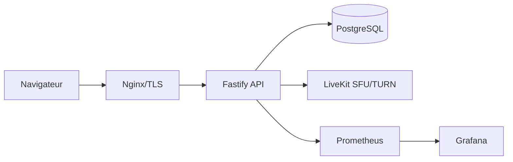

# Spécification réalisée — ChatISEN v1

## Périmètre

J1 couvre inscription, session opaque, recherche de handle, conversation directe et de groupe, historique persistant, ordre par séquence, livraison temps réel et appel audio/vidéo à deux. J2 ajoute gestion de membres, pièces jointes de 5 MiB, reprise de socket, badge de qualité et conférence LiveKit dans le profil Compose. J3 contient IaC, supervision, backup, charge, analyse et dossier de remise.

## Architecture

L’identité et l’autorisation résident dans le module API. PostgreSQL conserve utilisateurs, sessions, membres, événements, messages, appels, fichiers et échantillons de qualité. Les pistes média restent dans LiveKit. Le profil standalone conserve la même surface HTTP sur un journal JSON pour que le jury puisse exécuter la recette sans téléchargement.

## Règles

- UUID pour les identifiants ; instants serveur en UTC ; séquences monotones par conversation.
- Cookie `__Host-chatisen` HttpOnly, SameSite=Lax, Secure en production ; jeton CSRF HMAC pour toute mutation navigateur.
- Un message ne devient visible qu’après son écriture durable ; la clé client rend les retries idempotents.
- Un membre actif est requis pour historique, abonnement, appel et téléchargement.
- Fichier borné à 5 MiB, empreinte SHA-256, type admis contrôlé et téléchargement privé.
- Les contrôles de groupe sont refusés au tiers et au membre sorti ; un propriétaire actif est conservé côté schéma SQL.

## Matrice PDF → preuve

| Exigence | Implémentation | Preuve |
|---|---|---|
| Comptes et sessions | `apps/standalone/server.mjs`, `apps/api/src/identity` et migration | F01, S01 |
| Direct/groupe/historique | routes conversations, séquences et table events/messages | F02–F05 |
| Audio/vidéo | routes calls, jetons LiveKit du profil Compose | F06–F08 |
| Fichier/écran | route multipart, UI et plan LiveKit | F09–F10 |
| Qualité et reprise | événements, métriques et scripts `analysis/` | F11–F12, A01–A03 |
| Déploiement et supervision | Compose, Nginx, Prometheus/Grafana, runbooks | O01–O08 |
| Sécurité | CSRF, contrôle d’appartenance, headers, rapports | S01–S05 |
| Performance et remise | k6, rapport, conducteur et index d’artefacts | P01–P04, D01–D03 |
